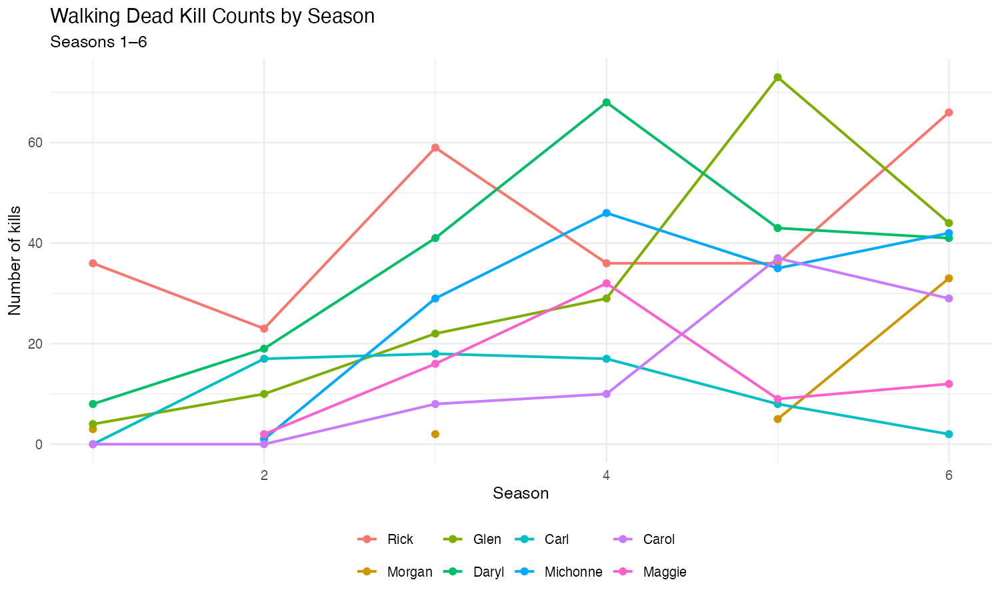
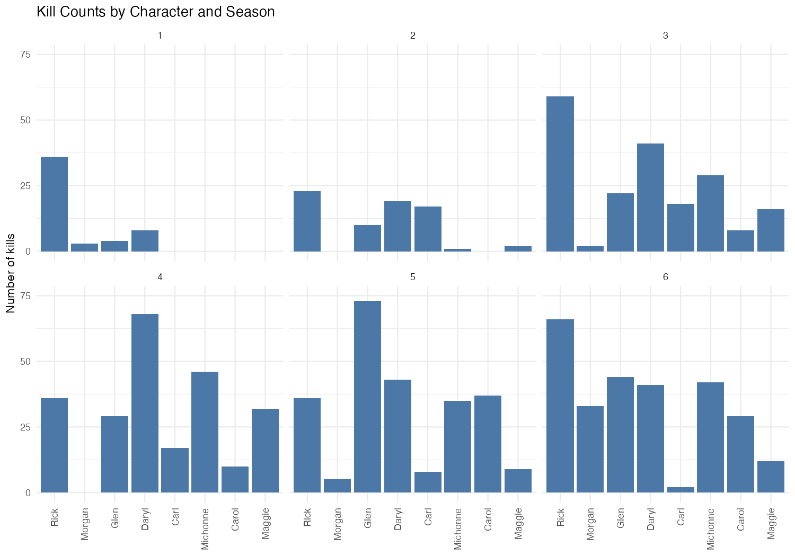
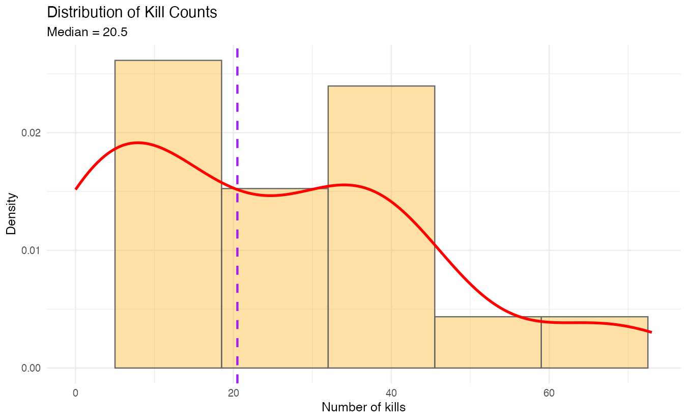

# Walking Dead Kill Counts

ggplot2 exercise that builds a small character-level dataset, reshapes it from wide to long with `reshape2::melt`, and plots kill counts across seasons.

## Question
How do kill counts vary by character and season, and what does the distribution look like across characters?

## Data
Kill counts for eight characters (Rick, Morgan, Glen, Daryl, Carl, Michonne, Carol, Maggie) over seasons 1–6. The data is defined in the script (no separate CSV). Some values are `NA`.

## Files
- [`walking-dead.R`](walking-dead.R): setup, reshape, and ggplot2 plots (histograms, density overlays, line/point plots, facets).
- [`images/`](images): plot previews from the script.







## How to run
```r
install.packages(c("ggplot2", "reshape2"))
source("walking-dead.R")
```

## Skills shown
- Building and cleaning a `data.frame`
- Wide → long reshape with `melt`
- ggplot2 aesthetics, scales, themes, and facets
